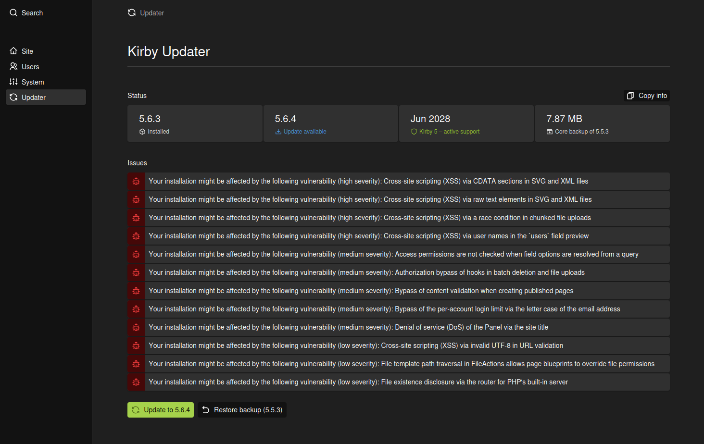

# Kirby Updater

Update the Kirby core of a manually installed (non-Composer) Kirby 5 site to the latest patch or minor release, right from the Panel.



## How it works

1. Admins get an **Updater** entry in the Panel menu showing the installed and the latest available version of the current major release, plus known security issues.
2. On update, the release archive is downloaded from GitHub, extracted into `site/kirby-updater/tmp/` and validated (required files, version, PHP requirement).
3. Only then is the current `kirby/` folder moved to `site/kirby-updater/backup-<timestamp>-<version>/` and the new folder moved in place.
4. If anything fails after the swap, the backup is moved back automatically.
5. The latest backup can be restored manually from the Updater view. This deletes the current `kirby/` folder without a backup.

**Only the `kirby/` folder (the Kirby core) is backed up and replaced. Content, the `site/` folder (including plugins and accounts) and `media/` are neither touched nor backed up, so keep your regular site backups.**

Backups and temporary files are kept in `site/kirby-updater/`, which Kirby's server configs block from web access, so the old (possibly vulnerable) core is never publicly reachable. Add this folder to your `.gitignore`.

Major upgrades are never offered and stay a manual task. The update is refused for:

- Composer installs, use `composer update getkirby/cms` there
- a symlinked `kirby/` folder, since it may be shared with other sites
- a `kirby/` folder managed by git (e.g. a submodule)

## Requirements

- Kirby 5
- PHP `ZipArchive`
- Write access of the web server user to the `kirby/` folder, its parent folder and the `site/` folder
- `kirby/` and `site/` on the same filesystem

## Options

```php
// site/config/config.php
return [
  'devmount.kirby-updater' => [
    // number of kirby folder backups to keep
    'backups'    => 1,
    // false only allows patch updates
    'allowMinor' => true,
    // false, true (requests the Panel login page) or a URL
    // that is requested after the swap, rolling back on a 5xx response
    'smokeTest'  => false,
  ],
];
```

## Limitations

- Plugins may be incompatible with a new minor release. Use "Restore backup" in that case.
- Any changes made inside the `kirby/` folder are replaced by the update. They only survive in the backup until the next update removes it.
- GitHub archives have no published checksums, so the download is validated by structure and version only.

## License

This plugin is licensed under the [MIT License](LICENSE).
